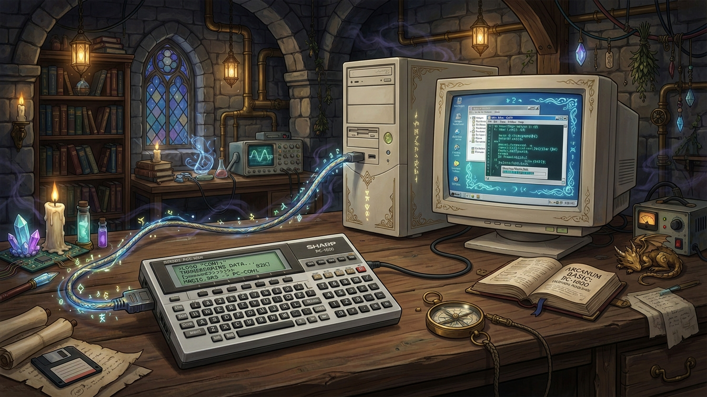

#  SerComet

**File transfer tool for PC and Sharp pocket computers.** A small Windows program (version 1.3) that sends and receives BASIC programs
between a PC and a pocket computer through a serial port (a USB-UART / USB-RS232 adapter), with a few helpers around it: the
Saver/Loader programs for the Sharp PC-1500 and PC-1600, a built-in BASIC tokenizer / detokenizer, a terminal and a log.

Free for personal, non-commercial and educational use ([PolyForm Noncommercial License 1.0.0](LICENSE.md)).

## Computers

| Target | How |
|---|---|
| Sharp PC-1500 | Software Serial through the Saver/Loader (4800 baud, TX = PC7, RX = PB2), or RS-232 text through the CE-158(X) |
| Sharp PC-1600 | Software Serial through the Saver/Loader (1200 to 19200 baud), or its RS-232 port |
| Other Sharp | pocket computers with the 15-pin connector (PC-1350, PC-1360, PC-E500 ...), TTL-UART text transfer |
| Casio FX-850P / FX-870P | TTL-UART, 300 to 4800 baud |
| TRS-80 Model 100 / NEC PC-8201 | RS-232, 300 to 19200 baud |
| UART Other | any computer with a UART interface, TTL or RS-232 |

## What is in this repository

| Folder | Contents |
|---|---|
| [`SerComet/`](SerComet) | the Windows program: C# WinForms source (Visual Studio 2019, .NET Framework 4.7.2): `Form1.cs`, `Form1.Designer.cs`, `Program.cs`, `SerComet.ico` |
| [`SL/PC-1500/`](SL/PC-1500) | **Saver/Loader for the PC-1500(A)**: LOAD and SAVE of BASIC programs through the software UART, 4800 bps: LH5801 source, BASIC installer, tape recording (WAV), simulator test |
| [`SL/PC-1600/`](SL/PC-1600) | **Saver/Loader for the PC-1600**: Z-80 source, BASIC installer (1200 to 19200 bps), emulator test, test programs |
| [`img/`](img) | pictures |

The Saver/Loaders are small machine-language routines that a short BASIC installer puts in the RAM of the pocket computer; after that
`CALL` sends the program in memory to SerComet and `CALL` loads one from it. They are based on the software UART of
[UART7.3 for the PC-1500](https://github.com/Ante1000/Sharp_PC-1500_Software_UART) and
[UART1600 for the PC-1600](https://github.com/Ante1000/sharp_pc-1600_software_uart).

## Building the program

Create a Windows Forms project in Visual Studio (.NET Framework 4.7.2), add the files of [`SerComet/`](SerComet) and build. There is nothing else to install.
The settings are kept in `settings.ini` (next to the program, or in `%AppData%\SerComet`).

## Author

Alex Matczewski F4VTS. Bug reports, suggestions, questions, contact: alex.f4vts@gmail.com.
YouTube: [youtube.com/@anteamber](https://www.youtube.com/@anteamber)
